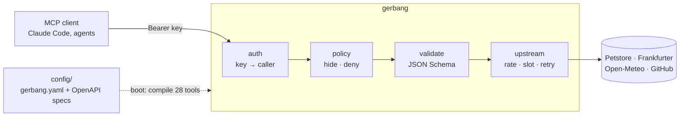
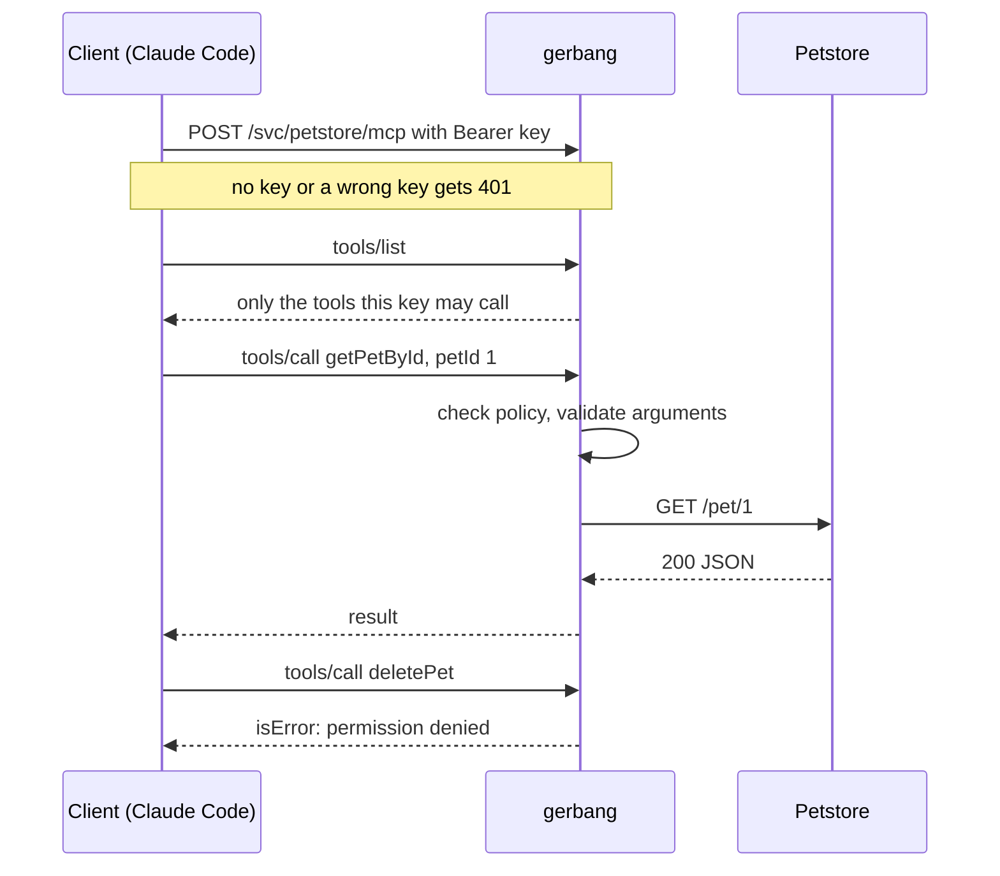
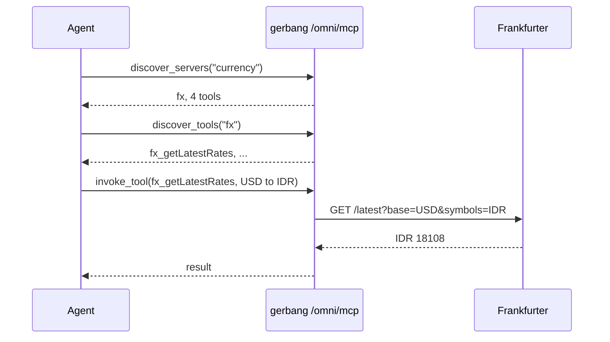

# gerbang: a recook of Uber's MCP Gateway

*recook*: read a production design, understand it, rebuild its core small. *gerbang* is Indonesian for "gate".

## Summary

One MCP gateway that exposes existing REST APIs as MCP tools straight from their OpenAPI specs, with **no change to the services**. Every call goes through one door: API keys, per-tool access rules, argument validation, limits and an audit log. 4 public APIs, 28 tools, about 1,150 lines of Go.

## Problem

From Uber's [Designing MCP Gateway](https://www.uber.com/us/en/blog/designing-mcp-gateway/) (Oct 2026):

> "Individual teams independently built integrations, leading to fragmentation in tooling and duplicated infrastructure."
>
> "MCP tools were hard to discover, difficult to operate reliably, and tightly coupled to specific services"

Their answer: *"Existing APIs are the fastest way to provide tools to an agent."*

## What I learned

- **Stateless** No sessions, so any replica serves any request.
- **Discovery beats loading.** All 28 tools cost 57 KB of context; omni's 4 meta-tools cost 2.5 KB.

## How it works



From the client's side:



Endpoints: `/svc/<name>/mcp` (one API), `/bundle/<name>/mcp` (a curated set), and `/omni/mcp` (discovery):



Adding a service is config only: a folder with its OpenAPI spec and a `service.yaml`.

## Demo

```sh
go run ./cmd/gerbang -check   # validate config, list the 28 tools
go run ./cmd/gerbang          # serve on 127.0.0.1:8080
```

```sh
mcp() { curl -s 127.0.0.1:8080$1 -H "Authorization: Bearer $2" -H 'Content-Type: application/json' \
          -H 'Accept: application/json, text/event-stream' -d "$3" | sed -n 's/^data: //p'; }
list='{"jsonrpc":"2.0","id":1,"method":"tools/list"}'

mcp /bundle/pet-shop/mcp dev-key-ops-bot "$list" | jq -r '.result.tools[].name'   # agent: 6 read tools
mcp /bundle/pet-shop/mcp dev-key-alice   "$list" | jq -r '.result.tools[].name'   # human: 11, with writes
```

Then connect Claude Code and ask *"weather in Jakarta now, and 100 USD in IDR?"*:

```sh
claude mcp add --transport http gerbang http://127.0.0.1:8080/omni/mcp \
  --header "Authorization: Bearer dev-key-ops-bot"
```

## Recook vs original

| Uber MCP Gateway | gerbang |
|---|---|
| IDL registry (Protobuf, Thrift) | Folder of OpenAPI specs |
| AutoCrawler + registry UI | `expose:` list in `service.yaml` |
| HTTP, gRPC, TChannel | HTTP (JSON) |
| Access Control System | Roles + actor type + tool patterns |
| Omni MCP | `/omni/mcp`, same 4 tools |
| Response projection, Code Mode | Not built |